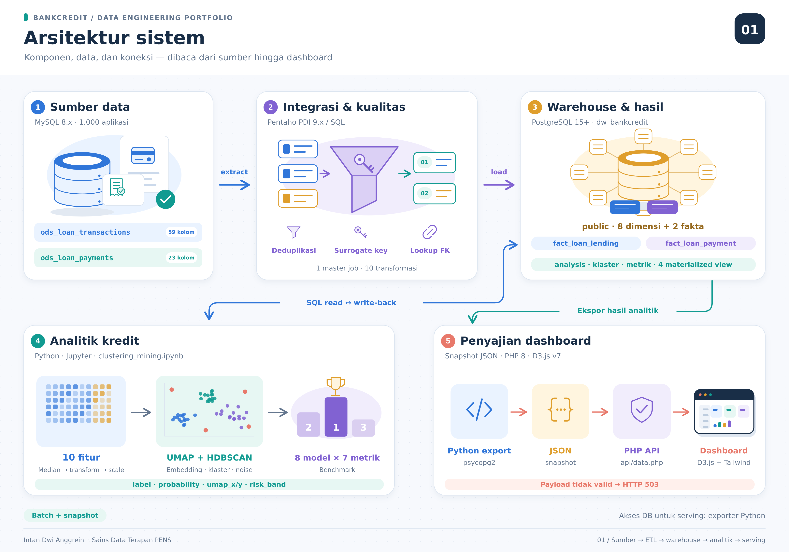
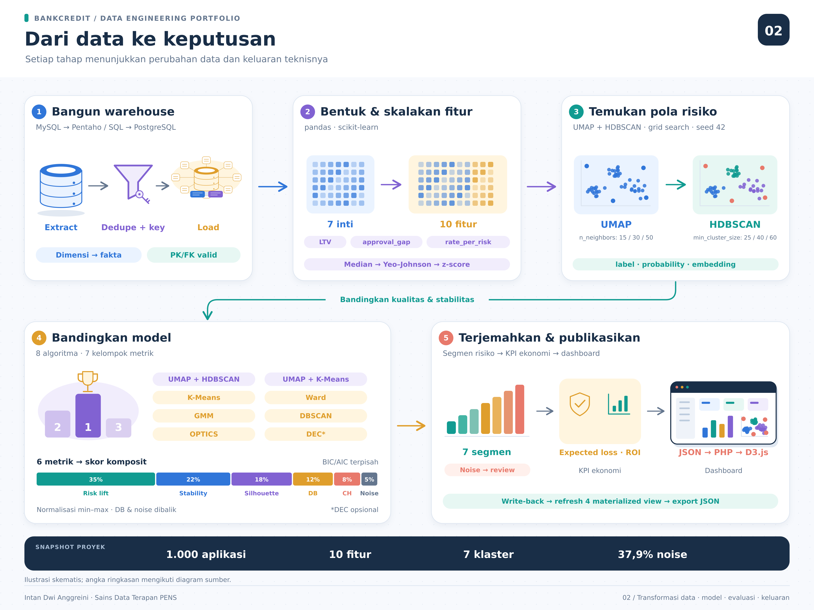
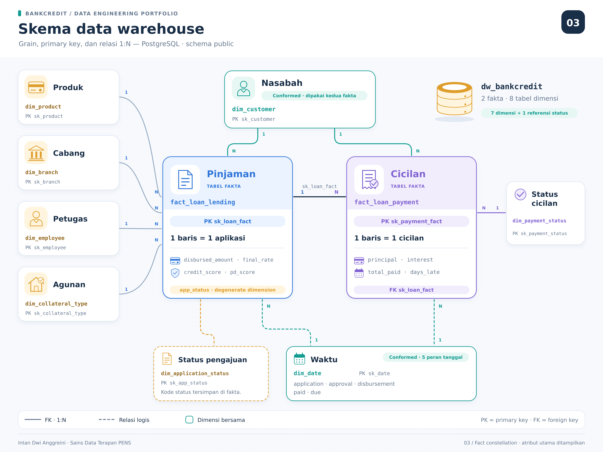

<h1 align="center">Segmentasi Profil Risiko Berlapis &amp; Deteksi Anomali Kredit</h1>
<h3 align="center">UMAP + HDBSCAN pada Data Warehouse Perkreditan Bank</h3>

<p align="center">
  Pipeline analitik <strong>end-to-end</strong>:
    <em>Operational Data Store → ETL → Star Schema Data Warehouse → Data Mining tak terawasi → Dashboard keputusan interaktif</em>
</p>

<p align="center">
  
  
  
  
  
  
  
  
</p>

<p align="center">
  
  
  
  
</p>

---

## Overview Project

Penilaian risiko kredit sebelum dana dicairkan merupakan tahap krusial bagi lembaga keuangan, namun pendekatan 
credit scoring konvensional yang bersifat terawasi sering gagal menangkap pola risiko tersembunyi dan aplikasi 
anomali. Penelitian ini membangun pipeline analitik end-to-end yang mengintegrasikan proses Extract-Transform
Load (ETL) dari Operational Data Store (ODS) menuju data warehouse berskema bintang, dilanjutkan eksplorasi data 
mining tak terawasi untuk membentuk segmentasi profil risiko berlapis. Data 1.000 aplikasi pinjaman dari dua tabel 
ODS ditransformasikan menjadi delapan tabel dimensi dan dua tabel fakta menggunakan Pentaho Data Integration 
serta skrip SQL. Sepuluh fitur finansial direduksi dengan Uniform Manifold Approximation and Projection (UMAP), 
kemudian dikelompokkan menggunakan Hierarchical Density-Based Spatial Clustering of Applications with Noise 
(HDBSCAN). Kombinasi UMAP dengan HDBSCAN dibandingkan dengan tujuh algoritma lain memakai tujuh 
metrik berprioritas. Hasil menunjukkan UMAP dengan HDBSCAN menempati peringkat pertama dengan Silhouette 
0,781, Davies-Bouldin 0,34, dan kemampuan mengisolasi 37,9% aplikasi sebagai anomali. Terbentuk tujuh segmen 
risiko berjenjang, termasuk segmen Hidden Prime yang layak persetujuan otomatis. Temuan disajikan melalui 
dashboard web interaktif yang menampilkan default rate 25%, ROI rata-rata 43%, dan total laba Rp 83,78 miliar guna 
mendukung pengambilan keputusan stakeholder.

---

## Hasil Utama

<table>
<tr>
<td width="25%" align="center"><strong>0,781</strong><br><sub>Silhouette Score<br>(ruang embedding UMAP)</sub></td>
<td width="25%" align="center"><strong>0,34</strong><br><sub>Davies-Bouldin Index<br>(makin rendah makin baik)</sub></td>
<td width="25%" align="center"><strong>7 + 1</strong><br><sub>Segmen risiko berjenjang<br>+ kelompok anomali</sub></td>
<td width="25%" align="center"><strong>37,9%</strong><br><sub>Aplikasi terisolasi<br>sebagai anomali</sub></td>
</tr>
</table>

**Temuan dengan nilai bisnis tertinggi — segmen *Hidden Prime*.** Sebanyak 79 aplikasi (7,9%) memiliki `credit_score` yang tampak biasa saja, namun rasio utang rendah dan nilai agunan kuat sehingga sebenarnya berisiko rendah. Kelompok ini tidak terlihat oleh *credit scoring* satu-skor, tetapi layak memperoleh persetujuan otomatis dengan harga yang lebih kompetitif.

**Indikator portofolio pada dashboard** (1.000 pinjaman, total pencairan Rp 203,97 miliar):

| Indikator | Nilai |
| :--- | ---: |
| Tingkat gagal bayar (*default rate*) | **25,0 %** |
| ROI rata-rata | **43,0 %** |
| Total laba bersih | **Rp 83,78 miliar** |
| Rata-rata credit score portofolio | 575 |

---

## Arsitektur Teknologi Sistem



Sistem disusun atas **lima lapisan** yang terpisah berdasarkan tanggung jawabnya :
| Lapisan | Teknologi | Peran |
| :--- | :--- | :--- |
| **1 · Sumber Data** | MySQL 8.x | Operational Data Store: `ods_loan_transactions` (59 kolom) dan `ods_loan_payments` (23 kolom) |
| **2 · ETL Engine** | Pentaho Data Integration 9.x atau SQL | Jalur setara Pentaho Data Integration : 1 *master job* + 10 transformasi, Jalur SQL : script `01_database/00_create_database.sql`–`03_load_facts.sql` |
| **3 · Data Warehouse** | PostgreSQL 15+ | Star schema untuk database `dw_bankcredit` dengan 8 tabel dimensi dan 2 tabel fakta |
| **4 · Lapisan Analitik** | Algoritma UMAP + HDBSCAN | Notebook data mining + schema `analysis` berisi hasil klastering, view ekonomi, dan 4 *materialized view* |
| **5 · Presentasi** | PHP V. 8 | Dashboard web interaktif yang membaca snapshot JSON hasil ekspor Python |

---

## Workflow Sistem

Workflow sistem dibagi menjadi lima fase berurutan, dari ekstraksi ODS hingga dashboard report :

```mermaid
flowchart LR
    subgraph A["A · ETL & Data Warehouse"]
        A1["ODS MySQL 8.x<br/>2 tabel sumber"] --> A2["Transform<br/>dedupe · surrogate key · lookup"]
        A2 --> A3[("dw_bankcredit<br/>8 dim + 2 fakta")]
    end
    subgraph B["B · Praproses"]
        B1["10 fitur finansial<br/>7 inti + 3 rekayasa"] --> B2["Yeo-Johnson<br/>+ StandardScaler"]
    end
    subgraph C["C · Reduksi & Klastering"]
        C1["UMAP grid search"] --> C2["HDBSCAN<br/>min_samples = 10"]
        C2 --> C3["7 klaster + 37,9% noise"]
    end
    subgraph D["D · Evaluasi"]
        D1["8 algoritma x 7 metrik"] --> D2["Skor komposit berbobot"]
        D2 --> D3["Peringkat 1:<br/>UMAP + HDBSCAN"]
    end
    subgraph E["E · Bisnis & Dashboard"]
        E1["Penamaan segmen<br/>+ risk band"] --> E2["Model ekonomi<br/>EL · ROI"]
        E2 --> E3["schema analysis<br/>+ 4 materialized view"]
        E3 --> E4["Dashboard D3.js"]
    end
    A3 --> B1
    B2 --> C1
    C3 --> D1
    D3 --> E1
```



<details>
<summary><strong>Short Workflow Sistem :</summary>



</details>

---

## Schema Data Warehouse

- `fact_loan_lending` bergranularitas **satu baris per aplikasi pinjaman** dan menjadi sumber utama data mining.
- `fact_loan_payment` bergranularitas **satu baris per cicilan** dan menjadi sumber penandaan gagal bayar. 
- `dim_customer` dan `dim_date` berperan sebagai *conformed dimension* yang dipakai kedua tabel fakta.



| No. | Tabel | Tipe | Granularitas / Kunci | Atribut utama |
| :-: | :--- | :--- | :--- | :--- |
| 1 | `dim_customer` | Dimensi | `sk_customer` | `customer_id`, `risk_segment`, `credit_grade` (11 atribut) |
| 2 | `dim_product` | Dimensi | `sk_product` | `product_id`, `product_type`, `interest_rate` (8) |
| 3 | `dim_branch` | Dimensi | `sk_branch` | `branch_id`, `city`, `region` (6) |
| 4 | `dim_employee` | Dimensi | `sk_employee` | `employee_id`, `role` (3) |
| 5 | `dim_collateral_type` | Dimensi | `sk_collateral_type` | `type_name`, `ltv_ratio` (4) |
| 6 | `dim_date` | Dimensi | `sk_date` | `full_date`, `month`, `quarter`, `year` (9) |
| 7 | `dim_payment_status` | Dimensi | `sk_payment_status` | 4 baris: Lunas, Belum Bayar, Tertunggak, Bayar Sebagian |
| 8 | `dim_application_status` | Dimensi | `sk_app_status` | `app_status_code` |
| 9 | `fact_loan_lending` | **Fakta** | 1 baris / aplikasi (**1.000**) | `disbursed_amount`, `pd_score`, `dti_ratio`, `credit_score`, `final_rate` |
| 10 | `fact_loan_payment` | **Fakta** | 1 baris / cicilan | `principal`, `interest`, `total_paid`, `days_late` |

**Schema `analysis`** menampung seluruh keluaran data mining agar dashboard dapat membaca hasil tanpa menjalankan ulang notebook:

- `loan_cluster_assignment` : label klaster per pinjaman, `probability`, koordinat `umap_x`/`umap_y`, dan `risk_band`.
- `algo_comparison` : tujuh metrik untuk delapan algoritma beserta `composite_rank`.
- `v_loan_econ`, `v_kpi_summary` : view ekonomi (PD, LGD, *expected loss*, ROI) dan summary KPI.
- 4 *materialized view*: `mv_cluster_profile`, `mv_top5_product_default`, `mv_top3_risk_roi`, `mv_top3_customer_profit`

---

## Metodologi

### 1) Dataset dan fitur

Data mining dijalankan pada **1.000 aplikasi pinjaman** menggunakan **tujuh variabel inti** — `credit_score`, `dti_ratio`, `pd_score`, `approved_amount`, `final_rate`, `appraised_value`, `tenor_months` dengan **tiga rasio finansial hasil rekayasa fitur** sehingga total menjadi sepuluh fitur:

| Fitur rekayasa | Formula | Makna bisnis |
| :--- | :--- | :--- |
| `ltv` | `approved_amount / appraised_value` | Loan-to-Value yang menandakan makin tinggi makin berisiko |
| `approval_gap` | `(requested_amount − approved_amount) / requested_amount` | Seberapa besar pengajuan ditolak analis |
| `rate_per_risk` | `final_rate / (pd_score × 100 + 1)` | Harga per unit risiko yang ditanggung |

### 2) Praprocess

Distribusi nominal rupiah sangat miring, sehingga diterapkan **PowerTransformer (Yeo-Johnson)** untuk menstabilkan varians, dilanjutkan **StandardScaler** untuk normalisasi z-score:

$$z = \frac{x - \mu}{\sigma}$$

### 3) Reduksi dimensi dengan UMAP dan klastering dan HDBSCAN

*Hyperparameter search* dijalankan atas kombinasi berikut (`random_state = 42`, `metric = euclidean`):

| Komponen | Ruang pencarian |
| :--- | :--- |
| UMAP `n_neighbors` | {15, 30, 50} |
| UMAP `min_dist` | {0,0 ; 0,1} |
| UMAP `n_components` | {2, 5} |
| HDBSCAN `min_cluster_size` | {25, 40, 60} |
| HDBSCAN `min_samples` | 10 |

**Kriteria pemilihan konfigurasi terbaik:** Silhouette pada ruang embedding tanpa titik *noise* ≥ 0,70 dan jumlah klaster 2 ≤ k ≤ 8 · *noise rate* pada tingkat wajar dan separasi bisnis tinggi.

Relevansi bisnis klaster diukur dengan **skor risiko komposit** yang menggabungkan probability of default, DTI, credit score, suku bunga, dan LTV dalam bentuk z-score:

$$R = z(PD) + z(DTI) - z(credit) + z(rate) - z(LTV)$$

### 4) Metrik evaluasi

Berikut tujuh metrik evaluasi menurut urutan prioritas : 

| Prioritas | Metrik | Keterangan |
| :-: | :--- | :--- |
| 1 | **Business Separation** (risk lift) | Rentang skor risiko rata-rata antar klaster — seberapa tajam segmen memisahkan risiko nyata |
| 2 | **Cluster Stability** | Rata-rata Adjusted Rand Index atas 8 kali *bootstrap* subsampel 80% |
| 3 | **Silhouette** | $s(i) = \dfrac{b(i) - a(i)}{\max\{a(i), b(i)\}}$ |
| 4 | **Davies-Bouldin** | $DB = \dfrac{1}{k}\sum_i \max_{j \neq i} \dfrac{\sigma_i + \sigma_j}{d(c_i, c_j)}$ — makin rendah makin baik |
| 5 | **Calinski-Harabasz** | Rasio dispersi antar-klaster terhadap dalam-klaster |
| 6 | **Noise rate** | Persentase titik yang tidak masuk klaster manapun |
| 7 | **BIC / AIC** | Khusus Gaussian Mixture Model |

Ketujuh metrik evaluasi diatas digabung menjadi satu **skor komposit berbobot** setelah normalisasi min-max per metrik:

$$S = 0{,}35 \cdot BS + 0{,}22 \cdot Stab + 0{,}18 \cdot Sil + 0{,}12 \cdot (1-DB) + 0{,}08 \cdot CH + 0{,}05 \cdot (1-Noise)$$

### 5) Model ekonomi

Sebuah pinjaman ditandai **default** jika memiliki minimal satu pembayaran berstatus *Overdue* atau keterlambatan lebih dari 90 hari (*NPL proxy*). Dengan asumsi **Loss Given Default (LGD) = 0,45** untuk pinjaman ritel beragunan parsial:

```text
gross_interest = disbursed_amount × final_rate/100 × tenor_months/12
expected_loss  = pd_score × 0,45 × disbursed_amount
net_profit     = gross_interest − expected_loss
ROI            = net_profit / disbursed_amount
```

---

## Hasil Segmentasi Risiko

Clustering terbaik memberikan hasil **tujuh segmen risiko berjenjang** dan satu kelompok anomali. Penamaan dilakukan dengan mengurutkan klaster non-noise menurut skor risiko rata-rata, lalu memetakannya ke *risk band* operasional.

| Segmen | n | Share | Profil ringkas | Risk Band |
| :--- | --: | --: | :--- | :--- |
| **Hidden Prime** | 79 | 7,9 % | Credit score sedang, DTI rendah, agunan kuat | 🟢 Auto-Approve |
| **Prime Stabil** | 55 | 5,5 % | Credit score tinggi, risiko rendah | 🟢 Auto-Approve |
| **Standar** | 111 | 11,1 % | Profil rata-rata seimbang | 🔵 Standard |
| **Berkembang** | 107 | 10,7 % | Pinjaman tumbuh, agunan besar | 🟡 Enhanced Review |
| **Berisiko Tinggi** | 43 | 4,3 % | PD tinggi, suku bunga tinggi | 🟡 Enhanced Review |
| **Risiko Sangat Tinggi** | 183 | 18,3 % | DTI dan PD tinggi, suku bunga tinggi | 🔴 Manual Review |
| **Ekstrem** | 43 | 4,3 % | Outlier risiko ekstrem | 🔴 Manual Review |
| **Anomali / Noise** | 379 | 37,9 % | Tidak masuk arketipe manapun | 🔴 Manual Review |

**Mengapa *noise rate* 37,9% bukan kelemahan.** Silhouette dihitung pada titik non-noise di ruang embedding, sehingga tujuh klaster yang terbentuk tetap padat dan terpisah. Dalam konteks filtering **pra-pencairan**, kemampuan mengisolasi aplikasi yang tidak menyerupai arketipe manapun justru berfungsi sebagai mekanisme kehati-hatian dimana 379 aplikasi tersebut diarahkan ke *underwriting* manual, sejalan dengan praktik terbaik deteksi *fraud* finansial berbasis metode unsupervides.

---

## Perbandingan Delapan Algoritma

| # | Algoritma | BS ↑ | Stab ↑ | Sil ↑ | DB ↓ | CH ↑ | Noise % |
| :-: | :--- | --: | --: | --: | --: | --: | --: |
| **1** | **UMAP + HDBSCAN** | **3,42** | **0,91** | **0,781** | **0,34** | **4.120** | 37,9 |
| 2 | UMAP + K-Means | 2,60 | 0,78 | 0,690 | 0,55 | 3.650 | 0,0 |
| 3 | Deep Embedded Clustering (DEC) | 2,35 | 0,72 | 0,640 | 0,61 | 3.320 | 0,0 |
| 4 | Gaussian Mixture (GMM) | 2,10 | 0,74 | 0,602 | 0,78 | 2.980 | 0,0 |
| 5 | K-Means | 1,95 | 0,69 | 0,586 | 0,83 | 3.110 | 0,0 |
| 6 | Agglomerative (Ward) | 1,88 | 0,66 | 0,564 | 0,86 | 2.870 | 0,0 |
| 7 | DBSCAN | 1,40 | 0,58 | 0,470 | 1,12 | 1.980 | 22,0 |
| 8 | OPTICS | 1,32 | 0,55 | 0,441 | 1,21 | 1.840 | 18,0 |

<sub>BS = Business Separation · Stab = Cluster Stability · Sil = Silhouette · DB = Davies-Bouldin · CH = Calinski-Harabasz. Untuk GMM: BIC = 19.720 dan AIC = 19.310.</sub>

**Interpretasi.** Keunggulan UMAP + HDBSCAN bersumber dari kemampuan UMAP memproyeksikan manifold data berdimensi tinggi ke ruang rendah sehingga klaster menjadi padat dan terpisah, lalu HDBSCAN membentuk klaster berbasis kepadatan **tanpa menetapkan jumlah klaster di awal** sekaligus mengisolasi titik anomali. UMAP + K-Means dan DEC menyusul di peringkat kedua dan ketiga; DBSCAN dan OPTICS paling lemah pada data berdimensi tinggi.

---

## Dashboard Stakeholder

Dashboard menyajikan temuan dalam bentuk yang langsung dapat dijadikan sebagai penyajian insight dan bahan pertimbangan pengambil keputusan.

**Komponen visual:**

- **Baris KPI** : Terdiri dari default rate, ROI rata-rata, total laba bersih, dan total pencairan.
- **Profil Segmentasi Risiko** : Disajikan dengan grafik batang bertumpuk atas skor ternormalisasi tujuh variabel kunci per segmen.
- **Frekuensi Segmentasi** : Divisualisasikan menggunakan *bubble chart* dengan luas gelembung proporsional terhadap jumlah pinjaman tiap segmen.
- **Top 5 Produk** berdasarkan *default rate* tertinggi.
- **Top 3 Customer Segment** berdasarkan profitabilitas.

**Temuan dari dashboard:**

| Peringkat produk (pencairan tertinggi) | Nilai |
| :--- | ---: |
| Korporasi Product 27 | Rp 2,57 miliar |
| KUR Product 91 | Rp 2,02 miliar |
| Investasi Product 55 | Rp 1,76 miliar |

| Segmen nasabah paling menguntungkan | Total laba |
| :--- | ---: |
| Sub-Prime | Rp 31,31 miliar |
| Elite | Rp 15,98 miliar |
| Prime | Rp 15,17 miliar |

Segmen **Sub-Prime menjadi segmen paling menguntungkan** dimana indikasi bahwa penetapan harga berbasis risiko (*risk-based pricing*) pada portofolio ini bekerja efektif, karena premi risiko yang dibebankan melebihi kerugian yang diharapkan.

---

© 2025 Intan Dwi Anggreini

STr. Sains Data Terapan — Politeknik Elektronika Negeri Surabaya

✉️ intandwianggreini99@ds.student.pens.ac.id

Dosen Pengampu MK: Dr. Edi Satriyanto, S.Si., M.Si.
